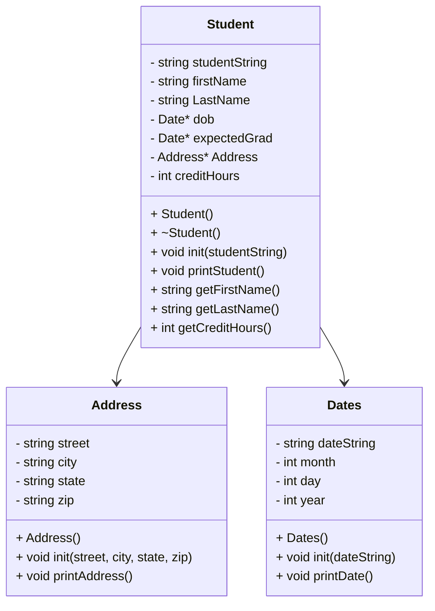

# CS121HeapofStudents

## UML

## main

## int main():
```
  create a vector of Student pointers called students
  call loadStudents to load the vector from the file

  set keepGoing to true
  while keepGoing:
    call menu function to get string response
    if response is "0":
      set keepGoing to false
    if response is "1":
      go to showStudentNames function - pass ref to students
    if response is "2":
      go to printStudents function - pass ref to students
    if response is "3":
      go to findStudent - pass ref to students
    if response is anything else:
      ask for a valid input (covers everything else)

  call delStudents and remove everything that is on the heap
  return 0
```

## void loadStudents(std::vector<Student*>&)
```
  create file input stream inFile
  create string currentLine

  open up inFile with students.csv

  read each line into currentLine
    create a new instance of Student on the heap
    call the student's init method using currentLine
    push that student to the back of the vector
  
  close the input file
```

## void printStudents(std::vector<Student*>&)
```
  for each student on the vector:
    print student data
    print a seperating line
```

## void showStudentNames(std::vector<Student*>&)
```
  for each student on the vector:
    print student last then first name
    print creditHours
```

## void findStudent(std::vector<Student*>&)
```
  create a string called enteredName
  print "Enter part of a last name to search: "
  let user type in text

  set bool found to false
  for all students in the vector:
    if the student last name != npos:
      print student data
      print a seperating line
      set bool found to true
```

## void delStudents(std::vector<Student*>&)
```
  for each student on the vector:
    delete student
  clear students
```

## std::string menu();
```
  create string named choice
  
  print an empty line
  print option 0
  print option 1
  print option 2
  print option 3
  print "choose 0-3: "

  put user input in choice
  return choice
```

## classes



## Dates::Dates()
```
  set dateString to ""
  set month to 0
  set day to 0
  set year to 0
```

## void Dates::init(dateString)
```
  set std::dateString to dateString
  create a stringstream
  create temporary month string
  create temporary day string
  create temporary year string

  getline of month string
  getline of day string
  getline of year string

  clear stringstream

  convert temporary variables
```

## std::string Dates::getDateStr()
```
  create a stringstream
  create an array with strings of all the months and NULL
  add month, day, and year to a string
  return the string
```

## void Dates::printDate()
```
  print the date string
```

## Address::Address()
```
  set street to ""
  set city to ""
  set state to ""
  set zip to ""
```

## void Address::init(street, city, state, zip)
```
  set Address::street to street
  set Address::city to city
  set Address::state to state
  set Address::zip to zip
```

## void Address::printAddress()
```
  print street and new line
  print city, state
  print zip and new line
```

## Student::Student()
```
  set studentString to ""
  set firstName to ""
  set lastName to ""
  set dob to new Dates
  set expectedGrad to new Dates
  set address to new Address
  set creditHours to 0
```

## Student::Student(std::string studentString)
```
  Student::init(studentString)
```

## Student::~Student()
```
  delete dob
  delete expectedGrad
  delete address
```

## void Student::init(studentString)
```
  set Student::studentString to studentString

  create a stringstream
  create a string for street
  create a string for city
  create a string for state
  create a string for zip
  create a temp string for firstName
  create a temp string for lastName
  create a temp string for dob
  create a temp string for grad date
  create a temp string for credit hours

  do str on studentString

  getline for firstname
  getline for lastname
  getline for street
  getline for city
  getline for state
  getline for zip
  getline for dob
  getline for graddate
  getline for credithours

  set firstName to temp firstName
  set lastName to temp lastName
  address->init(street, city, state, zip)
  dob->init(temp dob)
  expectedGrad->init(temp graddate)

  clear stringstream
  do str on temp creditHours
  ss >> creditHours
```

## void Student::printStudent()
```
  print firstName then lastName
  print address
  print dob
  print grad date
  print creditHours
```

## std::string Student::getLastFirst()
```
  set lastFirst string to lastName plus firstName
  return lastFirst
```

