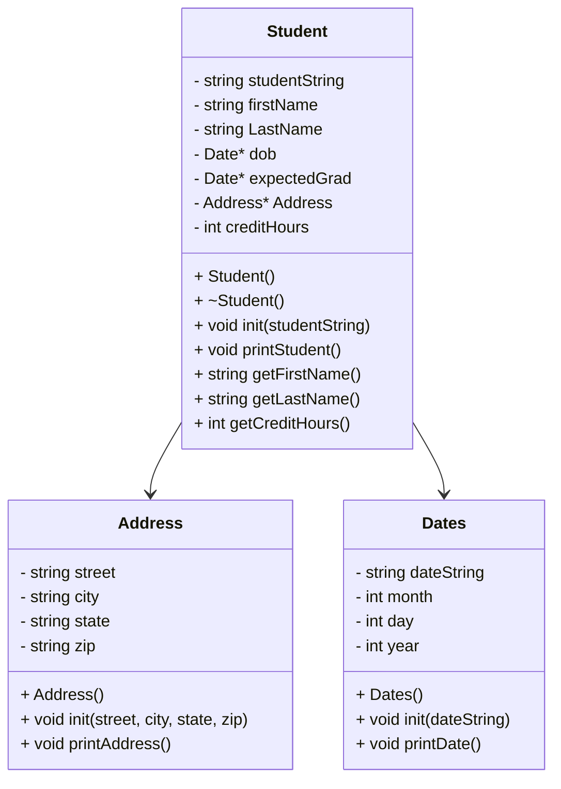

# CS121HeapofStudents

## UML



## Dates::Dates()
```
  set dateString to ""
  set month to 0
  set day to 0
  set year to 0
```

## void Dates::init(dateString)
```
  set std::dateString to dateString
  create a stringstream
  create temporary month string
  create temporary day string
  create temporary year string

  getline of month string
  getline of day string
  getline of year string

  clear stringstream

  convert temporary variables
```

## std::string Dates::getDateStr()
```
  create a stringstream
  create an array with strings of all the months and NULL
  add month, day, and year to a string
  return the string
```

## void Dates::printDate()
```
  print the date string
```

## Address::Address()
```
  set street to ""
  set city to ""
  set state to ""
  set zip to ""
```

## void Address::init(street, city, state, zip)
```
  set Address::street to street
  set Address::city to city
  set Address::state to state
  set Address::zip to zip
```

## void Address::printAddress()
```
  print street and new line
  print city, state
  print zip and new line
```

## Student::Student()
```
  set studentString to ""
  set firstName to ""
  set lastName to ""
  set dob to new Dates
  set expectedGrad to new Dates
  set address to new Address
  set creditHours to 0
```

## Student::Student(std::string studentString)
```
  Student::init(studentString)
```

## Student::~Student()
```
  delete dob
  delete expectedGrad
  delete address
```

## void Student::init(studentString)
```
  set Student::studentString to studentString

  create a stringstream
  create a string for street
  create a string for city
  create a string for state
  create a string for zip
  create a temp string for firstName
  create a temp string for lastName
  create a temp string for dob
  create a temp string for grad date
  create a temp string for credit hours

  do str on studentString

  getline for firstname
  getline for lastname
  getline for street
  getline for city
  getline for state
  getline for zip
  getline for dob
  getline for graddate
  getline for credithours

  set firstName to temp firstName
  set lastName to temp lastName
  address->init(street, city, state, zip)
  dob->init(temp dob)
  expectedGrad->init(temp graddate)

  clear stringstream
  do str on temp creditHours
  ss >> creditHours
```

## void Student::printStudent()
```
  print firstName then lastName
  print address
  print dob
  print grad date
  print creditHours
```

## std::string Student::getLastFirst()
```
  set lastFirst string to lastName plus firstName
  return lastFirst
```

